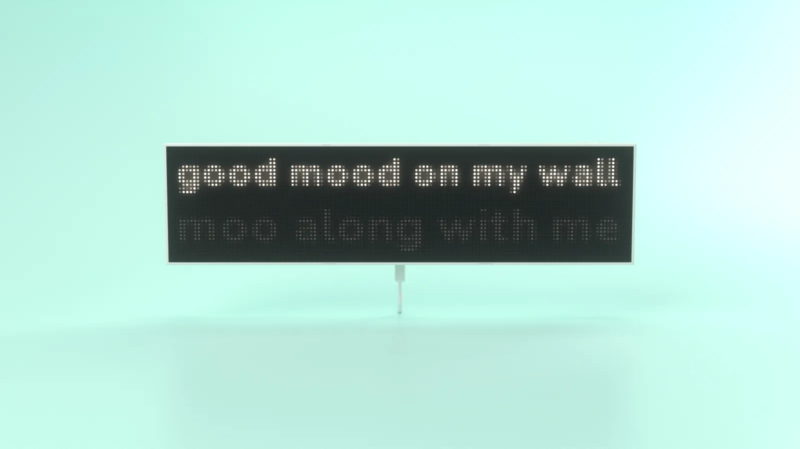
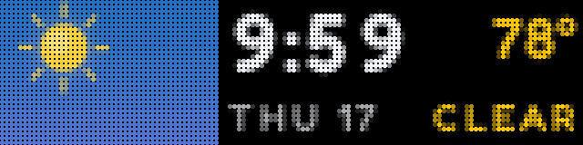
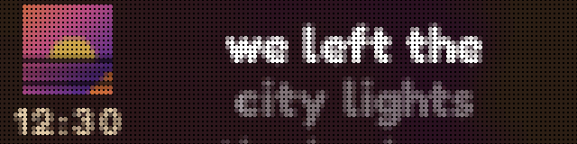

<p align="center">
  <picture>
    <source media="(prefers-color-scheme: dark)" srcset="brand/kit/lockup-dark.svg">
    
  </picture>
</p>

<p align="center">Put your wall in a good mood.</p>

<p align="center">
  <a href="https://mooboard.co">mooboard.co</a> &nbsp;·&nbsp; <a href="https://mooboard.co/start/">Get started</a>
</p>

<p align="center"></p>

<p align="center">
  
  
  
  
  
  
</p>

<br>

The site at mooboard.co, served by GitHub Pages from this repo.

```sh
python3 tools/serve.py    # http://127.0.0.1:8091
```

<sub>© 2026 mooboard co. Fonts and scripts keep their own licenses. More in <a href="docs/notes.md">notes</a>.</sub>
